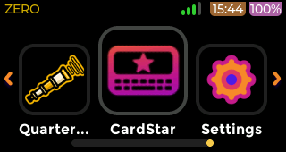
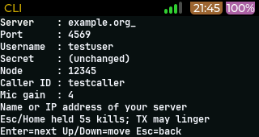
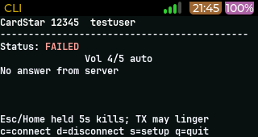

# CardStar

An **unofficial** client for the M5Stack CardputerZero that works with
AllStarLink nodes, connecting over IAX2. CardStar is not affiliated with,
endorsed by, or supported by AllStarLink.

You need an AllStarLink node or server that you are allowed to use, with an
IAX2 login that can dial the node.

**A valid amateur radio license is required to transmit.**

## Screenshots

All values shown are made up.

*Launcher*

*Setup (changing saved settings)*

*Connection failed*

## First run

CardStar asks for: server, port (blank = 4569), username, secret, node
number, and an optional caller ID (digits are sent as a number, anything
else as a name; your server may override it), and mic gain (1 to 10, blank = 4).
Press Enter to move to the next field; Enter on the last field saves.
Esc quits on the first-run setup screen, and goes back without saving when you
are changing existing settings.

On the secret field, Left or Right arrow shows or hides it (anyone looking at
the screen can read it then). The CardputerZero's built-in terminal cannot
paste. To paste a long secret, run `/usr/share/APPLaunch/bin/cardstar` over SSH
from a computer, press `d`, then `s`.

Settings are saved in `~/.config/cardstar/config`, readable only by your user.
The secret is stored there as plain text, because it is needed to log in.
CardStar keeps no log. Uninstalling leaves the settings file in place.

## Login security

CardStar logs in with the server's MD5 challenge, so the secret itself is not
sent. If a server asks for plain-text login instead, CardStar refuses, hangs up
and shows "Server wants plain-text login: refused". It never sends the secret
as plain text.

## Mic gain

4 is normal. Raise it if others say you are quiet. While transmitting, the
screen shows your loudest level; if it sits near 100%, turn the gain down.
Above 4, loud peaks are rounded off rather than clipped.

## Keys

| Key | Does |
|---|---|
| Space | start / stop transmitting (stops by itself after 120 seconds, or at once if the microphone stops) |
| 0-9 * # then Enter | send a DTMF command |
| + / - | receive volume |
| c / d | connect / disconnect |
| s | change settings (disconnect first) |
| q | quit (main and transmit screens) |
| Esc | in setup: quit on first run, back when changing settings |

**Stop transmitting before you leave, and quit with q.** Holding Esc/Home for
about 5 seconds force-quits the app and can leave the node transmitting until
the server times out.

On units with the ES8389 sound chip, CardStar raises the microphone gain while
it runs and puts your old value back when it exits normally.

## Building

On a Debian system: `sh packaging/build.sh` (needs `dpkg-deb`). Nothing is
downloaded.

## License

Copyright (C) 2026 TheBeardedHamm

CardStar is licensed under **GPL-2.0-only** (see `LICENSE`). It includes the
unmodified [iax2 0.1.0b2](https://github.com/AllStarLink/py-iax2) library,
Copyright (C) 2026 Jason D. McCormick, also GPL-2.0-only.
